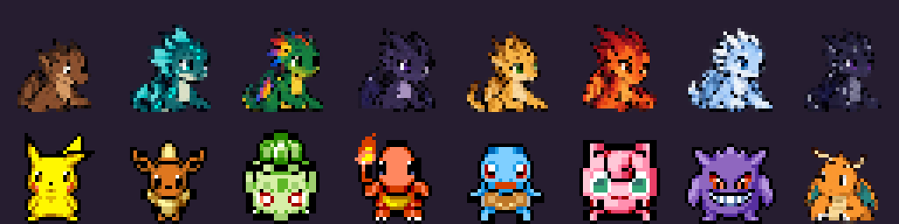
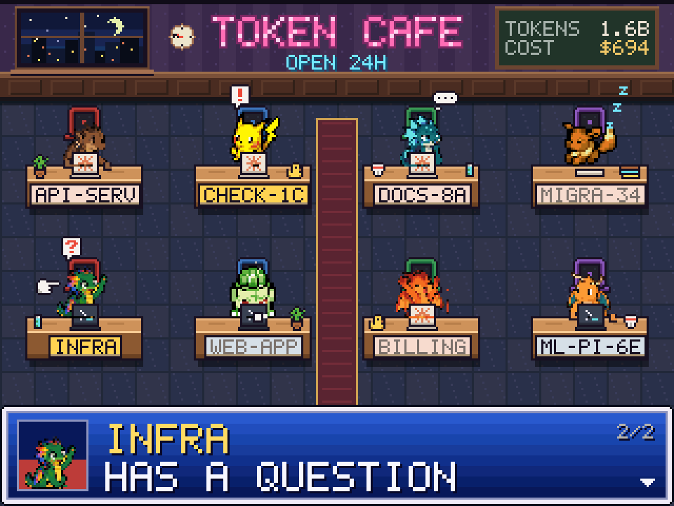

<div align="center">

# ☕ Token Café

**Your AI coding agents, as regulars at a pixel-art night café.**

Claude Code and Codex sessions running on your machine take a seat, including local sessions in their macOS desktop apps.
They type while they work, nap while you're away, and raise a hand when they need you.


</div>

> [!TIP]
> **Linux and macOS supported.** Windows contributors are welcome; see [porting notes](#windows-porting-notes).

## What you're looking at

Each session is a patron. The desktop starts with a mixed dragon/Pokémon roster, with distinct creatures assigned to the eight seats. The human roster retains the original session-derived skin, hair and clothes. What they're doing tells you what your agent is doing:

| Your agent is… | The patron… |
|---|---|
| **Working** | types away; the laptop lid shows Claude's spinning asterisk or Codex's blinking prompt, keys fly off the keyboard, and a `…` thought bubble pops up now and then |
| **Idle** | stretches, fetches a coffee after 2 minutes, and falls asleep on a closed laptop after 10 |
| **Waiting for you** | raises a hand: `!` for a permission prompt, `?` for a question. The nameplate blinks and the message window calls them out by name, cycling through everyone waiting |

New sessions walk in from the door and finished ones walk out. Claude occupies the four seats left of the aisle; Codex occupies the four on the right. Additional sessions wait outside until a seat on their provider’s side frees up.

<div align="center">

</div>

Up on the wall, **the tab** keeps a running total for the calendar month: tokens used and what they'd cost at the vendors' list prices, Claude and Codex together. (If you're on a subscription, that's a measure of how much you've used, not a bill.) When nobody needs you, the message window shows who's working, who's on a break, and the time.

<div align="center">

<br><sub>3 a.m.: one agent still working, the rest have dozed off.</sub>
</div>

## Getting started

You need [Rust](https://rustup.rs) 1.88 or newer and a C compiler (SQLite is built in), on macOS or a Linux Wayland/X11 desktop. On macOS, install Apple’s Command Line Tools (`xcode-select --install`) for the C compiler. From a clone of this repository:

```sh
cargo build --release
./target/release/token-cafe
```

On macOS you can also build a local app bundle to launch from Finder or keep in the Dock:

```sh
./tools/build_macos.sh
open "target/release/Token Café.app"
```

The bundle is for local use; it is not signed for distribution or notarized. Finder launches use the default agent directories; use the terminal command when you need shell environment overrides.

| Command | |
|---|---|
| `token-cafe` | the live café |
| `token-cafe --demo` | a full house showing every pose, no agents needed |
| `token-cafe --print` | list the live sessions and this month's usage in the terminal, then exit |
| `token-cafe --scale N` | open at N × 320×240 (default 3) |

| Key | |
|---|---|
| `P` | cycle human / dragon / Pokémon / mixed rosters |
| `Tab` | select the next seat |
| `[` / `]` | previous / next character for the selected seat |
| `1` – `6` | resize the window to that many times 320×240 |
| `f` / `F11` | fullscreen (nice on a spare monitor) |
| `Esc` | leave fullscreen |
| `q` | quit |

The café is drawn at 320×240 and scaled by the largest whole number that fits, so the pixels stay crisp at any window size; the rest is letterboxed. Only what changes on screen is repainted, so a live café costs about 1% of a CPU core.

> [!NOTE]
> On a tiling window manager the window gets tiled like any other. Its Wayland app id and X11 class are both `token-cafe`, so you can write a window rule to float or pin it.

## Patron characters



Choose `humans`, `dragons`, `pokemon`, or `mixed` (default). Eight Wings of Fire-inspired dragons and eight Pokémon are bundled, using generated dragon/Dragonite pose sheets and credited PMDCollab Pokémon animations; see [art sources, credits and generation prompt](assets/patrons/SOURCES.md).

```sh
./target/release/token-cafe --demo --patrons dragons
./target/release/token-cafe --patrons mixed --seat 1=winter --seat 4=eevee
./target/release/token-cafe --list-patrons
```

Press **P** to cycle rosters, **Tab** to select the next seat, and **[ / ]** to change that seat's character. Seat 1 is initially selected; seats run left-to-right across the top row, then the bottom row. The title shows the selected seat and character, and editing highlights its desk. Selecting a creature already assigned elsewhere swaps the two seats. Humans can repeat, keeping their individual session-derived appearance. Changing rosters resets all seat choices.

`--seat N=NAME` can be repeated; assignments apply in order after `--patrons`, regardless of option position. Choices last for the current run; use startup arguments to reproduce a layout. Assignments belong to seats, including empty seats, and survive session refreshes. Creature portraits match their seat characters. Creatures have separate animated typing, thinking, waving, sipping, sleeping and stretching poses. Seated bodies sit behind the desk; alternating forepaws overlap the keyboard area. Walking uses gait frames and rear views for upward travel. The human roster retains its original animations.



The [visual QA record](docs/qa/REVIEW.md) includes paired pose frames, walking timelines, and native desktop screenshots.

Regenerate the art contact sheet with `python3 tools/build_patrons.py` (Pillow), and café previews with `cargo run --example screenshots -- --patrons`.

## How it knows

Everything is read locally; nothing leaves your machine. Token Café only reads files, and writes one cache file.

| | Where it looks |
|---|---|
| **Claude Code** sessions | `~/.claude/sessions/<pid>.json`: live CLI and desktop Code-tab sessions, with status and what they are waiting for. On macOS, desktop records in `~/Library/Application Support/Claude/claude-code-sessions/` supply chat titles and archive status |
| **Codex** sessions | running CLI and desktop `app-server` processes → their open rollout logs → whether each chat’s last task started or finished. Desktop chats get separate patrons, titled from `~/.codex/state_5.sqlite`; CLI sessions can also use its cwd fallback |
| **The tab** | every transcript under `~/.claude/projects/` and `~/.codex/sessions/` written this month; each API response carries its token counts |
| **Cache** | `~/Library/Caches/token-cafe/usage.json` on macOS; `~/.cache/token-cafe/usage.json` on Linux. `XDG_CACHE_HOME` overrides either default |

`CLAUDE_CONFIG_DIR` and `CODEX_HOME` are honoured. Codex doesn't log its approval prompts, so Codex patrons never raise a hand.

On macOS, native `libproc` and `sysctl` calls discover processes, working directories, arguments and open rollout files. Claude session identity is checked against its macOS process-start date, with `startedAt` as a fallback for older files. Processes macOS does not allow us to inspect are skipped.

Desktop discovery is automatic: launch Token Café without `--demo`. Codex gets one patron per loaded root chat with an open rollout log; helper processes, archived chats and subagent-only logs are excluded. CLI and desktop references to the same chat are deduplicated. Closing a chat removes its patron when the server releases the log; the desktop app can keep idle chats loaded in the background. Saved sidebar history alone does not count as a live session.

Claude desktop support covers the **Code tab's local Claude Code sessions**, preserving busy, idle and permission/question states. Ordinary Claude Chat, Cowork VM sessions, and cloud-only chats are not detected. Desktop titles/archive metadata refresh every five seconds; live status still refreshes every second. These local desktop formats can change between app versions.

## Under the hood

```
design/cafe.js          the art and the scene's behaviour, as pixel strings and plain JS
tools/gen_assets.mjs    turns it into src/assets.rs and src/bg.rgb
src/scene.rs            the café: seats, walking, poses, particles, message window, the tab
src/gfx.rs              rectangles, shadows, palette sprites, a 5×7 font
src/collect/            which sessions are live (procfs.rs for Linux, macos.rs for macOS)
src/usage.rs            this month's tokens and list-price dollars
src/app.rs              the window: winit + softbuffer, whole-number scaling, damage tracking
examples/screenshots.rs renders the images in this README
```

Changing the art means editing `design/cafe.js`, then:

```sh
node tools/gen_assets.mjs                          # regenerate the sprites and the room
cargo run --release --example screenshots          # refresh docs/*.png and docs/arrivals.gif
```

## Windows porting notes

The renderer and window dependencies are cross-platform, but Windows process discovery is not implemented. A Windows backend needs executable paths (`codex.exe`), arguments, working directories, process start times and open rollout files (or the existing SQLite fallback). It also needs native home/cache paths and validation of Claude's process identity format.

`token-cafe --print` checks live collection without opening a window; `--demo` shows the café without any running agents.

## Credits

The café started life on a 2.8″ ESP32-S3 desk display, as a little JRPG-style net café that sat next to the keyboard. This app brings the same patrons to your desktop.

Patrons render from 64×64 animation cells onto a 640×480 desktop frame, while furniture and text keep the original pixel grid. Dragon artwork is recompiled from the full-size sources; Pokémon retain their native sprite detail. Window shortcuts 1–6 keep their existing sizes.
