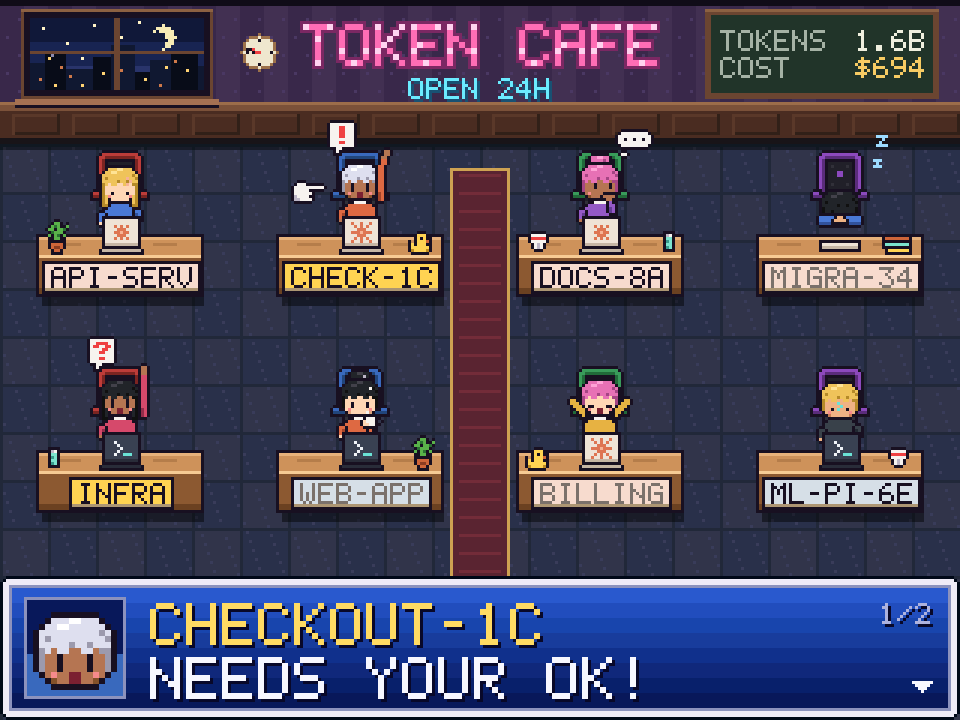
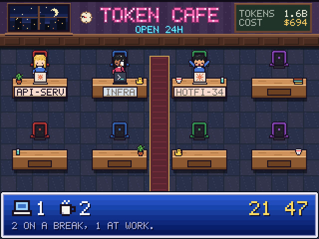
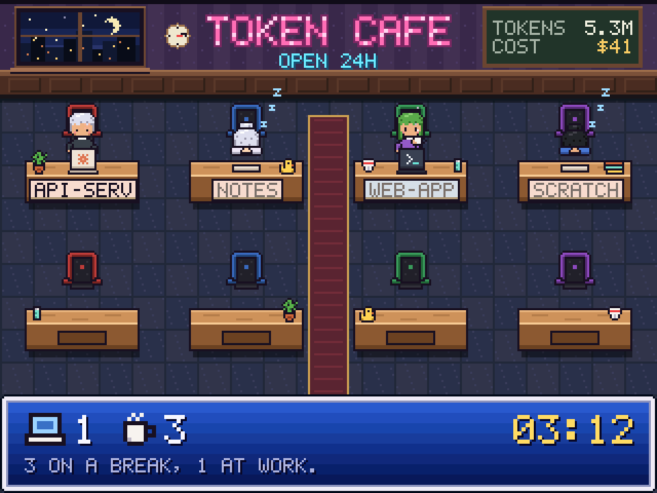

<div align="center">

# ☕ Token Café

**Your AI coding agents, as regulars at a pixel-art night café.**

Claude Code and Codex sessions running on your machine take a seat, including local sessions in their macOS desktop apps.
They type while they work, nap while you're away, and raise a hand when they need you.




</div>

> [!TIP]
> **Linux and macOS supported.** Windows contributors are welcome; see [porting notes](#windows-porting-notes).

## What you're looking at

Each session is a patron with their own look (skin, hair, shirt, hairstyle, all derived from the session id, so they're the same person every time). What they're doing tells you what your agent is doing:

| Your agent is… | The patron… |
|---|---|
| **Working** | types away; the laptop lid shows Claude's spinning asterisk or Codex's blinking prompt, keys fly off the keyboard, and a `…` thought bubble pops up now and then |
| **Idle** | stretches, fetches a coffee after 2 minutes, and falls asleep on a closed laptop after 10 |
| **Waiting for you** | raises a hand: `!` for a permission prompt, `?` for a question. The nameplate blinks and the message window calls them out by name, cycling through everyone waiting |

New sessions walk in from the door, finished ones walk out, and a ninth waits outside until a seat frees up.

<div align="center">

</div>

Up on the wall, **the tab** keeps a running total for the calendar month: tokens used and what they'd cost at the vendors' list prices, Claude and Codex together. (If you're on a subscription, that's a measure of how much you've used, not a bill.) When nobody needs you, working patrons take turns speaking for four seconds, with a one-second pause showing the café totals and clock. Each patron rotates through work chatter, their current Git branch (including linked worktrees or a detached commit), and the number of active direct Codex sub-agents observed in open rollout files. Unavailable details are skipped; Claude sub-agent counts are not currently collected. Permission requests and questions take priority.

<div align="center">

<br><sub>3 a.m.: one agent still working, the rest have dozed off.</sub>
</div>

## Getting started

You need [Rust](https://rustup.rs) 1.88 or newer and a C compiler (SQLite is built in), on macOS or a Linux Wayland/X11 desktop. On macOS, install Apple’s Command Line Tools (`xcode-select --install`) for the C compiler. From a clone of this repository:

```sh
cargo build --release
./target/release/token-cafe
```

On macOS you can also build a local app bundle to launch from Finder or keep in the Dock:

```sh
./tools/build_macos.sh
open "target/release/Token Café.app"
```

The bundle is for local use; it is not signed for distribution or notarized. Finder launches use the default agent directories; use the terminal command when you need shell environment overrides.

| Command | |
|---|---|
| `token-cafe` | the live café |
| `token-cafe --demo` | a full house showing every pose, no agents needed |
| `token-cafe --session-info` | local task/activity diagnostic as one JSON snapshot |
| `token-cafe --session-info --watch` | emit a snapshot when live session information changes |
| `token-cafe --print` | list the live sessions and this month's usage in the terminal, then exit |
| `token-cafe --always-on-top` | keep the café above other windows |
| `token-cafe --scale N` | open at N × 480×272 (default 1 on macOS, 3 elsewhere) |

| Key | |
|---|---|
| `1` – `6` | resize the window to that many times 480×272 |
| `f` / `F11` | fullscreen (nice on a spare monitor) |
| tap a patron / bottom summary / `Tab` | select a session and show its task |
| tap selected patron / empty desk | clear focus |
| tap main bottom banner / `Left` / `Right` | cycle patrons, including overflow |
| `Up` / `Down` / drag the scrollbar | page through the selected request |
| `Esc` | leave fullscreen, or clear session selection |
| `t` | toggle always on top (the title shows whether it is pinned) |
| `q` | quit |

On macOS, press `1` then `t` for a small floating café, or launch with `token-cafe --scale 1 --always-on-top`. It stays above ordinary windows when you switch apps in the same desktop Space. Press `t` again to unpin. The mode lasts until you quit; use the launch flag to start pinned.

On Linux X11, pinning depends on window-manager support. Wayland does not expose the window-level API: the title shows “Pin via compositor”, `T` leaves the window unpinned, and `--always-on-top` prints an explanation. Configure a compositor window rule using the `token-cafe` app ID instead.

The café is drawn at 480×272 and scaled by the largest whole number that fits, so the pixels stay crisp at any window size; the rest is letterboxed. Only what changes on screen is repainted, so a live café costs about 1% of a CPU core.

> [!NOTE]
> On a tiling window manager the window gets tiled like any other. Its Wayland app id and X11 class are both `token-cafe`, so you can write a window rule to float or pin it.

## How it knows

Everything is read locally; nothing leaves your machine. Token Café only reads files, and writes one cache file.

| | Where it looks |
|---|---|
| **Claude Code** sessions | `~/.claude/sessions/<pid>.json`: live CLI and desktop Code-tab sessions, with status and what they are waiting for. On macOS, desktop records in `~/Library/Application Support/Claude/claude-code-sessions/` supply chat titles and archive status |
| **Codex** sessions | running CLI and desktop `app-server` processes → their open rollout logs → whether each chat’s last task started or finished. Desktop chats get separate patrons, titled from `~/.codex/state_5.sqlite`; CLI sessions can also use its cwd fallback |
| **The tab** | every transcript under `~/.claude/projects/` and `~/.codex/sessions/` written this month; each API response carries its token counts |
| **Cache** | `~/Library/Caches/token-cafe/usage.json` on macOS; `~/.cache/token-cafe/usage.json` on Linux. `XDG_CACHE_HOME` overrides either default |

`CLAUDE_CONFIG_DIR` and `CODEX_HOME` are honoured. Codex doesn't log its approval prompts, so Codex patrons never raise a hand.

On macOS, native `libproc` and `sysctl` calls discover processes, working directories, arguments and open rollout files. Claude session identity is checked against its macOS process-start date, with `startedAt` as a fallback for older files. Processes macOS does not allow us to inspect are skipped.

Desktop discovery is automatic: launch Token Café without `--demo`. Codex gets one patron per loaded root chat with an open rollout log; helper processes, archived chats and subagent-only logs are excluded. CLI and desktop references to the same chat are deduplicated. Closing a chat removes its patron when the server releases the log; the desktop app can keep idle chats loaded in the background. Saved sidebar history alone does not count as a live session.

Claude desktop support covers the **Code tab's local Claude Code sessions**, preserving busy, idle and permission/question states. Ordinary Claude Chat, Cowork VM sessions, and cloud-only chats are not detected. Desktop titles/archive metadata refresh every five seconds; live status still refreshes every second. These local desktop formats can change between app versions.

## Under the hood

```
design/cafe.js          the art and the scene's behaviour, as pixel strings and plain JS
tools/gen_assets.mjs    turns it into crates/cafe-ui/src/assets.rs and bg.rgb
crates/cafe-ui/src/scene.rs  the café: seats, walking, poses, particles, message window, the tab
crates/cafe-ui/src/gfx.rs    rectangles, shadows, palette sprites, a 5×7 font
src/collect/            which sessions are live (procfs.rs for Linux, macos.rs for macOS)
src/usage.rs            this month's tokens and list-price dollars
src/app.rs              the window: winit + softbuffer, whole-number scaling, damage tracking
examples/screenshots.rs renders the images in this README
```

Changing the art means editing `design/cafe.js`, then:

```sh
node tools/gen_assets.mjs                          # regenerate the sprites and the room
cargo run --release --example screenshots          # refresh docs/*.png and docs/arrivals.gif
cargo run --example screenshots -- --monologues    # preview rotation in target/monologues.gif
```

### Attention alerts

A newly waiting patron pulses the full footer background for 30 seconds, then keeps an amber
frame until the request is resolved. A solid amber frame highlights the active
patron; other waiting patrons keep quiet corner markers and steady nameplates.
The footer shows the patron, approval/question type, a larger request preview,
and the waiting queue count. Framed VIEW REQUEST and NEXT controls make actions
visible; NEXT disappears when only one patron is waiting.
Tap the patron or footer to acknowledge the pulse; **VIEW REQUEST** opens the
existing review screen without approving anything. **NEXT** moves through waiting
patrons, including those outside the visible seats. Acknowledged requests remain
labeled SEEN - STILL PENDING. Review keeps the patron's name and matching portrait.
When a request ends, a brief REQUEST RESOLVED notice appears; unchanged old text
is labeled LAST REQUEST until fresh task text arrives. New alerts preserve a patron
you are already reading, and refreshes do not restart acknowledged alerts.

On the semantic companion board, a new waiting state or approval identity wakes
the backlight and keeps it awake for at least 60 seconds. Unchanged refreshes do
not extend that window; the usual ten-minute touch idle timer still applies.
Physical wake behavior requires updated board firmware as well as the matching
host build. Preview the new footer and its animation with:

```sh
cargo run --example screenshots -- --attention
```

## Windows porting notes

The renderer and window dependencies are cross-platform, but Windows process discovery is not implemented. A Windows backend needs executable paths (`codex.exe`), arguments, working directories, process start times and open rollout files (or the existing SQLite fallback). It also needs native home/cache paths and validation of Claude's process identity format.

`token-cafe --print` checks live collection without opening a window; `--demo` shows the café without any running agents.

## Credits

The café started life on a 2.8″ ESP32-S3 desk display, as a little JRPG-style net café that sat next to the keyboard. This app brings the same patrons to your desktop.

### Session information

Click a patron to show its latest request in the bottom panel. Requests wrap into two-line pages, with up to 19 characters per line. Use Up/Down, scroll the mouse wheel over the bottom panel, or click/drag its vertical scrollbar to read the request. Up/Down opens focus on page one when nothing is selected and stops at the first/last page. The scrollbar thumb shows position in the text; its full 44×48 surrounding region accepts taps. Tap the main banner or press Left/Right to switch patrons; the pointing hand, portrait, and task details change together. Tap the selected patron or an empty desk to clear focus; tap the unfocused bottom panel to open it. Tab cycles all live sessions, including those outside. Escape clears selection when not in fullscreen. Native touch taps are accepted on release, with drags, cancellation and duplicate emulated mouse input filtered. Selection stays with the session through updates; a closed session clears it. Approval/question alerts appear when unfocused; manual focus keeps a waiting count visible without blocking selection. Idle sessions show `LAST` rather than implying ongoing work. Unsupported font characters display as one `?` each.

`--session-info` reads transcripts only for sessions confirmed by the live collectors. It prints identity, project, state, the latest human-request excerpt, public assistant text, and the last observed tool action. Evidence includes its source and timestamp; tool actions also include the tool name. Idle sessions explicitly label the request as historical (`task_scope: last_request`). Missing details stay null with a state-based fallback.

`--session-info --watch` polls once a second and emits a complete JSON snapshot only when it changes, including an empty list when all sessions close. Stop with Ctrl-C. The same collector supplies the café focus panel. It makes no model/network calls. Its output contains local request excerpts, project paths, and transcript paths.

Tool status is conservative: `observed` means a call was logged, `returned` means its tool result arrived (not necessarily that a subprocess finished or tests passed), and `failed` requires an explicit Claude tool-error flag. A turn ending without a result is `ended_without_result`. Opaque wrapper tools show `USING TOOL` with their name. Raw tool arguments, output, and reasoning are not displayed. Request excerpts are limited to 160 characters, not AI-generated summaries; context-only and synthetic messages are skipped conservatively.

Codex details come from the matched root rollout. Claude transcript filenames must match the full live session ID under a top-level project directory; missing or ambiguous matches remain unavailable. Transcript discovery is refreshed every five seconds. On first read, at most the last 8 MiB is scanned, then only appended complete records; records over 1 MiB are skipped. `history_partial` flags truncated history or skipped oversized records, so an older task may be unavailable. File replacement/truncation clears cached evidence, and closed sessions evict it.

The macOS app icon reuses the café patron head. To regenerate it on macOS, run `swift tools/generate_icon.swift`, then `iconutil -c icns assets/TokenCafe.iconset -o assets/TokenCafe.icns`, and rebuild the bundle.

On macOS, double-click a patron in the app, or double-tap a patron on the Bluetooth companion screen, to open its existing Codex or Claude Desktop session. On the board, make two short taps at the same spot within 450 ms; slower taps select and clear focus. Single clicks still select or clear focus. CLI-only sessions without a desktop mapping cannot be opened this way. Claude navigation uses the installed Desktop app's `code/continue` route, which may change between versions.

On macOS, a pinned café becomes 60% opaque while unfocused, so the window behind it remains visible. Focusing the café or turning off pinning restores full opacity.

The macOS title bar hides while the café is unfocused and returns when you click back into the window.

### Platform behavior

| Feature | macOS | Linux X11 | Linux Wayland |
|---|---|---|---|
| Patron selection, task scrolling, keyboard and touch input | Yes | Yes | Yes |
| Always on top (`T` / `--always-on-top`) | Yes | Window-manager dependent | Configure a compositor window rule |
| Unfocused translucency and hidden title bar | Yes | Normal opaque window and decorations | Normal opaque window and decorations |
| Double-click to open a desktop session | Yes, with a known desktop session | Regular selection only | Regular selection only |
| Patron app-bundle icon | Yes | macOS bundle asset only | macOS bundle asset only |

Wayland does not expose the window-level API used for pinning. The title shows “Pin via compositor” and `T` does not claim to enable pinning there. Use the `token-cafe` app ID for compositor rules. macOS AppKit dependencies and native navigation code are compiled only on macOS.

## ESP32-S3 display prototype

A QEMU-only ESP32-S3 firmware prototype can display the café on a virtual
480×272 panel without a physical board or screen. See [firmware/README.md](firmware/README.md)
for installation, build/run commands, protocol tests, and hardware limitations.

### Bluetooth companion display

The JC4827W543 ESP32-S3 companion renders the café locally from synchronized
session state. BLE carries authenticated Protobuf state, actions and text blobs;
animations and pressed feedback do not wait for desktop framebuffer updates.
Run `tools/run_companion.sh` after provisioning, or `token-cafe --bluetooth` with
`TC_BLE_REGISTRY` pointing to your private board registry. Connection status stays
in the window title. Selection changes only through user interaction; the footer
no longer cycles through patrons automatically.

See [protocol and payloads](docs/protocol/companion-v2.md),
[setup and rollback](docs/protocol/operations.md), and
[validation results](docs/protocol/validation.md). Legacy framebuffer firmware
remains available for explicit rollback using `--bluetooth --bluetooth-key PATH`.
Never run the legacy and semantic connection paths against the same board.

### Patron seating

Claude patrons sit on the left; Codex patrons sit on the right. Each side is
numbered 1–2 across the top row and 3–4 across the bottom row. Working patrons and patrons waiting for input take priority, including when
the app starts or a walking patron settles. An active patron swaps into the
lowest-numbered earlier seat occupied by an idle patron on the same side.
Both patrons walk around the desks to exchange seats. Active patrons are never
displaced. Idle patrons keep their seats unless an active patron needs an earlier seat. Selection and
session links follow the patron. Swapping seats temporarily ignore taps until
the walkers settle; overflow sessions remain accessible from the banner.

### Native widescreen layout

The desktop and JC4827W543 companion now share a 480×272 canvas. The board
renders pixels locally at 1:1 scale; the desktop uses uniform integer scaling. Patrons,
font glyphs and icons keep square pixels. Wider desks show longer names, and the
task panel fits 32 characters per line. Touch coordinates map directly to the
rendered scene; update both app and firmware together for the new scrollbar area.
