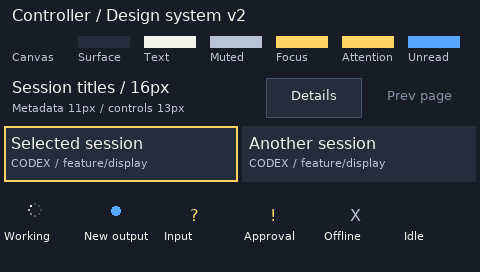
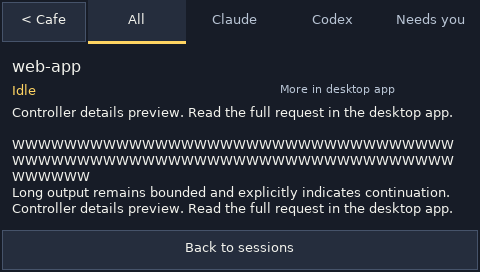

# Controller design system — v2

This is the implementation contract for Controller mode. The canonical tokens and components are in `crates/cafe-ui/src/controller_design.rs`. Desktop and ESP32 draw the same native **480×272** frame. Changes to this system apply to both; no second desktop stylesheet or board-specific replica is maintained. Café mode keeps its existing artwork, font and interactions.



## Foundations

### Semantic colors

| Token | RGB | Use |
| --- | --- | --- |
| `CANVAS` | `#171C27` | Screen and detail-page background |
| `SURFACE` | `#252D3D` | Session tiles and enabled control surfaces |
| `BORDER` | `#46536A` | Subtle button boundaries |
| `DISABLED` | `#8491A4` | Inactive controls, which also have inert hit targets |
| `TEXT` | `#F3F3ED` | Titles and primary labels |
| `SECONDARY` | `#B9C5D5` | Provider, branch, supporting text, working/offline icons |
| `FOCUS` | `#FFD462` | Board cursor and selected filter/order option |
| `ATTENTION` | `#FFD462` | Approval and question indicators |
| `UNREAD` | `#58A6FF` | New-output dot only |
| `NOTICE` | `#FFD462` | Request/result feedback; wording carries the outcome |

Focus and attention are different semantic roles even though v1 shares their color. Shape distinguishes them: a gold outline identifies the cursor; `!` and `?` identify waiting states. Blue never denotes selection. Surface fills remain neutral. Do not assign a different decorative color to each session or provider. Do not introduce new hex values in feature rendering code.

### Typography

| Role | Typeface | Native size | Usage |
| --- | --- | --- | --- |
| `Text::Title` | DejaVu Sans Book | 16px | Session and detail titles, prominent navigation |
| `Text::Control` | DejaVu Sans Book | 13px | Navigation, filters, feedback, status and detail preview |
| `Text::Caption` | DejaVu Sans Book | 11px | Provider/branch, counters, secondary labels |

The checked-in alpha atlas preserves case, proportional widths and antialiasing identically on desktop and board. Never scale the pixel-café font or use a platform-only system font. Session titles preserve authored case. Navigation controls use sentence case; provider captions retain uppercase provider names. Do not uppercase user content.

Use `label` for bounded single-line text and `text_width` for measurement. It adds a pixel-measured ellipsis when necessary; a tiny allocation receives only dots that fit, or no text. Essential status meaning must also appear in Details/OLED. v1's atlas covers printable ASCII; unsupported glyphs render as `?`. Broader Unicode requires an explicit atlas/size review, not another fallback font.

Regenerate the atlas with `python3 tools/gen_controller_font.py` (Pillow required only for generation). Include the existing DejaVu license when redistributing it.

### Geometry and spacing

All values are native framebuffer pixels, not desktop logical points. Structural spacing uses a **4px** unit. Existing **7px** tile text insets are an optical alignment exception, not a new general spacing scale.

| Region | Bounds / rule |
| --- | --- |
| Canvas | 480×272 |
| Header | 44px tall; 88px mode control plus four 98px filters |
| Session grid | Two columns × three rows; 234×56 tiles; 4px gutters |
| Footer | y=228, 44px tall |
| Previous / next page | 56×44 each |
| Order toggle | 116×44 |
| Details | 64×44 |
| Cursor outline | 2px, inset inside the tile |
| Title allocation | 202px, reserving space for the status icon |
| Notice allocation | 174px, independent of order/details controls |

`layout::tile`, `layout::filter` and footer rectangles supply **both drawing and hit-testing**. Rectangle edges are half-open; gutters are inert. Interactive regions are at least 44px in both dimensions. This is a pixel contract; actual finger comfort still requires a physical-board test. Desktop resizing scales the completed frame, leaving native layout unchanged.

## Reusable components

| Component | Contract |
| --- | --- |
| `label` | Case-preserving proportional text, bounded by measured pixel width |
| `tile` | Neutral surface; optional single gold cursor outline; no interaction side effects |
| `option` | Active order button using shared control chrome |
| `button`, `page_button` | Centered 13px actions; disabled state removes affordance and interaction |
| `centered` | Measured centering inside a padded allocation |
| `wrap` | Pixel-measured, lossless escaped preview with explicit truncation |
| `tab` | Bounded header label and one active underline |
| `notice` | Bounded request/result feedback, separate from adjacent controls |
| `StatusIcon` | One canonical icon, label and resolver for each known status |
| `Rect` | Shared rendering/input geometry; no view-specific hit-area copies |

These are drawing primitives: selection, navigation, filtering, protocol actions and desktop activation remain in their existing state/authority layers. Drawing a component must never dispatch an action or mark a session read. New components should accept semantic state and bounds rather than inspect global session state.

### Status semantics

| Semantic state | Primary icon | Canonical label |
| --- | --- | --- |
| Running turn | Loading ring | Working |
| Unread public output, otherwise idle | Blue dot | New output |
| Question | `?` | Waiting for input |
| Permission request | `!` | Waiting for approval |
| Disconnected | `X` | Disconnected |
| Idle and read | None | Idle |

The blue unread dot occupies a 10px diameter rather than the original ~7px mark. All icon ink remains inside the existing status allocation.

The primary icon precedence is disconnected → waiting → working → unread → idle. Unread is an orthogonal flag: status **sorting** deliberately places unread before working, even when a working ring remains the primary icon. These two policies serve different purposes and must not be silently conflated.

Use provider state when available. Do not turn idle into “Completed,” assume a warning means an execution failure, or infer unread from idle. Codex's persisted unread state is authoritative when its identity/host is unambiguous; otherwise use bounded observed public-output evidence. Never use reasoning or tool-result text as an unread signal.

## Interaction and state rules

- Gold means the board cursor; it never claims that the desktop is focused.
- Tap a session or press Open once to request its exact desktop target. Keep the overview visible.
- Knob rotation browses only. Top Previous/Next moves from the cursor and opens the next eligible session.
- Filters and sort changes never open sessions. Selection follows its stable session ID through sorting.
- Status ordering is Needs you → New output → Working → Idle, with disconnected last. Equal-priority ties use stable IDs.
- Details-only sessions must say so. Empty lists remain navigable as empty states, with no guessed activation.
- Preserve the session identity captured at touch-down. If a status update replaces that tile before release, cancel the gesture.
- “Opening” means dispatch is pending; “Open requested” means the handoff was accepted. “Focused” requires exact-session confirmation. A failure must not look like successful focus.
- Disconnected input is consumed without replay. Retained screen content does not enable navigation or decisions.
- Requested/success notices expire after 5 seconds to restore page information. Failures remain until the next navigation action.
- Previous/Next are visibly disabled and inert at page boundaries; a clamped page request preserves the cursor. Details is disabled without a selection.
- Summary counts are prefixed **All:** because they remain global while filtering.
- Details uses 13px status/body text with 16px line spacing and a bounded seven-line preview. Pixel-aware wrapping preserves text between lines; overflow explicitly says **More in desktop app**. Disconnected details use the canonical status label.
- Details returns after 30 seconds without navigation; board inactivity sleep is 60 minutes.
- The bottom keypad row remains Dictate in the focused app/session, Claude app, Codex app. The design system does not remap these actions.

For complete routing, synchronization, reconnect and installation semantics, see [Controller mode](controller-mode.md).

## OLED adaptation

The keypad's 128×32 monochrome OLED is a separate presentation adapter. It retains its supported font and quota layouts; do not squeeze the board's 16px titles or colors into it. Use the identical Café OLED presentation in both modes: existing provider icons, quotas, attention alerts, session-name navigation overlay, and both Claude allowance slots. Do not add a separate Controller display, mode/filter marker, or sort indicator to the OLED. Mode/filter/order belong to the main screen. Never rely on color alone for state that must be understood on OLED.

## Applying and evolving the system

1. Choose the existing semantic component, typography role and color token.
2. Use shared layout rectangles for rendering and input. Add a named layout token when a new region is necessary.
3. Bind to existing stable IDs and authority state; keep drawing free of actions.
4. Verify maximum-length titles, missing metadata, empty/overflow lists, unknown targets, all status icons and disconnected content.
5. Render the component reference and actual Controller fixture at native size. Check overlap, truncation and physical touch targets.
6. Run workspace tests, clippy, formatting and no-std compilation. For a device release, build the matching engine/app and follow the firmware acceptance procedure.

Commands:

```sh
cargo run --example controller_design
cargo run --example screenshots -- --controller
cargo test --workspace --locked
cargo clippy --workspace --all-targets --locked -- -D warnings
cargo fmt --all -- --check
cargo check -p companion-core --no-default-features --locked
```

Update this document, the tokens and the rendered reference together. Changing a color, font, geometry or icon requires a matching desktop/board build; design-system source and atlas bytes are included in the compatibility digest. Changes to hit-testing, status meaning or activation behavior require explicit review and behavioral tests. Increment `VERSION` for intentional component-contract changes and record the migration here. v1 establishes the existing Controller visual language and consolidates its implementation.

## v1 validation (historical)

273 workspace tests, clippy with warnings denied, formatting, no-std compilation and the ESP32-S3 engine build passed. The standard native Controller screenshot is pixel-identical before and after component extraction. Geometry tests cover all interactive target bounds and overlaps; typography tests cover proportional/case-sensitive measurement and ellipsis fitting down to zero width.

## v2 designer review and migration

An independent designer agent reviewed the native 480×272 overview and component sheet. The six-tile geometry and all minimum hit areas were retained. v2 adds a 13px Control role, visible neutral button chrome, centered labels, disabled boundary/no-selection states, a 10px unread dot, explicit global counts, readable measured Details wrapping, and bounded feedback duration.

The designer agent visually accepted the regenerated main overview/component sheet, requested the Details corrections recorded above, and then accepted the corrected Details render with no further important blocking findings. Physical checks remain necessary for 11px metadata, glare, adjacent targets and finger posture. This is a source/design revision; deployment requires matched desktop/board builds. It does not change Café mode or the bottom keypad row.



V2 validation: 280 workspace tests, clippy with warnings denied, formatting, no-std compilation and the ESP32-S3 engine build passed. Coverage includes inert disabled controls, cursor-preserving boundary navigation, feedback expiry/error persistence, and measured text wrapping without dropped spans.

### Working animation

The working ring uses eight clockwise intensity phases at 125ms per phase (one revolution per second), driven by the existing local scene clock. Only the icon pixels change; labels, tile positions, waiting icons and unread dots remain still. No extra host updates, timers, or Bluetooth messages are required. `StatusIcon::draw_at` is the runtime component; `draw` provides a fixed phase for static component references. Render the preview with `cargo run --example screenshots -- --controller --controller-animation`.
