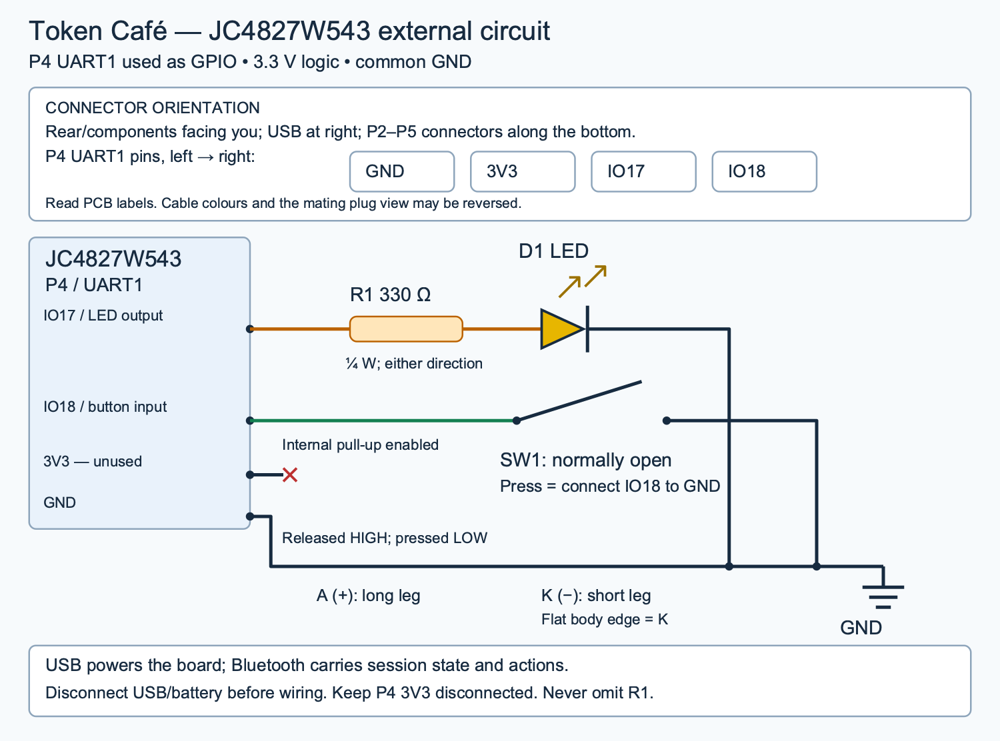
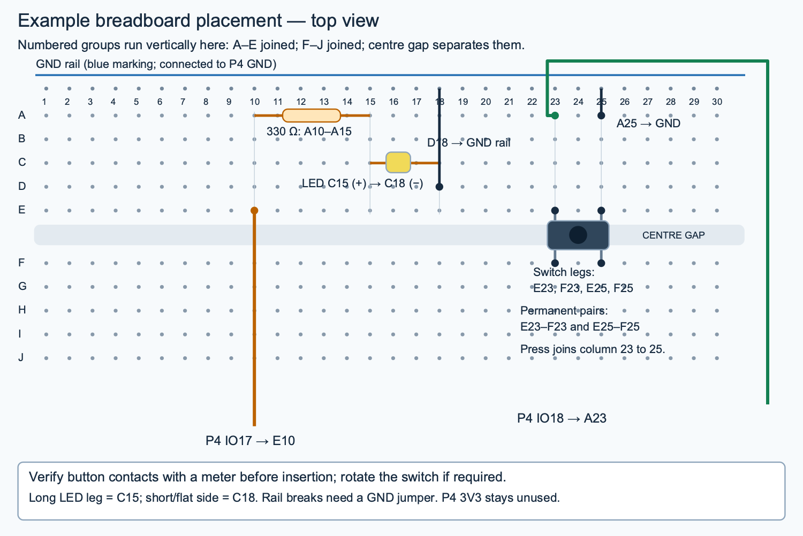

# Recreate the Token Café LED/button controller

This is the external circuit fitted to the **Guition JC4827W543 ESP32-S3**
480×272 display board. It uses the board's existing screen and P4 connector.
The electrical drawing documents our added circuit; it is not a reverse-engineered
schematic of the manufacturer's entire PCB. No additional ILI9488 screen is used.

Firmware implementation: `2376524` on `codex/approval-led-button`, including the
preceding attention, button-navigation and Bluetooth-recovery changes. Check out
this documentation's commit to retain the guide and matching source together.

## Parts

| Quantity | Part | Notes |
| --- | --- | --- |
| 1 | JC4827W543 ESP32-S3 display board | Tested unit uses NV3041A LCD and GT911 touch. |
| 1 | Small indicator LED | Tested discrete LED; polarity matters. |
| 1 | 330 Ω resistor, ¼ W | Orange–orange–brown, commonly gold tolerance band. |
| 1 | Normally open momentary pushbutton | Tested four-leg tactile switch; check terminal pairs. |
| 1 | Solderless breadboard | At least 30 numbered columns, centre gap and ground rail. |
| 1 | P4-compatible four-position cable | Confirm mechanical fit and each PCB signal; don't rely on wire colours. |
| As needed | Jumper wires | Adapt the board cable to the breadboard. |
| 1 | USB data cable and computer | Used for programming; USB supplies power in normal operation. |
| 1 | Multimeter | Verify continuity, resistor value and button contacts. |

## Connector and electrical schematic



[Editable SVG schematic](external-approval-schematic.svg)

Look at the **rear/component side**, with USB at the right and P2–P5 along the
bottom. Find **P4 / UART1**, not P5. On the photographed/tested PCB, P4's left-to-right
silkscreen is **GND, 3V3, IO17, IO18**. The mating cable viewed from its other side
can appear reversed. Confirm labels on the actual PCB before connecting.

| P4 label | Connection | Firmware behavior |
| --- | --- | --- |
| GND | LED cathode and one button contact through common ground rail | Common reference. |
| 3V3 | Leave unconnected; insulate its loose lead | Not needed by this circuit. |
| IO17 | 330 Ω resistor → LED anode (+) | Output HIGH lights LED; LOW turns it off. |
| IO18 | Other button contact | Input with internal pull-up; LOW means pressed. |

Net list:

```text
P4.IO17 ── R1 330 Ω ── D1 anode (+)
D1 cathode (−) ─────── P4.GND
P4.IO18 ── SW1 normally open ── P4.GND
P4.3V3 ── not connected
```

The LED's long leg is normally the anode. The short leg and flat rim mark the
cathode. If the leads have been trimmed, use the multimeter's diode mode to
identify polarity. The resistor can face either way. The tested LED initially
failed to light because it was reversed; reversing it fixed the circuit.

## Breadboard placement



[Editable SVG breadboard layout](external-approval-breadboard.svg)

This is a repeatable example layout, not a claim that every breadboard has the
same labels. Orient yours so each numbered group A–E is connected, each F–J is
connected, and the centre gap separates E from F. Verify the rail is continuous;
bridge any split in the rail with a jumper.

| Component / lead | Hole or connection |
| --- | --- |
| P4 GND | Blue-marked ground rail |
| P4 IO17 | E10 |
| R1 resistor | A10 to A15 |
| LED anode (+) | C15 |
| LED cathode (−) | C18 |
| Ground jumper for LED | D18 to ground rail |
| Switch legs | E23, F23, E25, F25, spanning centre gap |
| P4 IO18 | A23 |
| Ground jumper for switch | A25 to ground rail |

For this switch orientation, **E23–F23 must be permanently connected**, and
**E25–F25 must be permanently connected**. The two pairs must be disconnected
when released and connected only when pressed. Rotate the switch if necessary;
four-leg switches can have different physical layouts. Connecting IO18 and GND
to the same permanent pair makes the input read pressed all the time.

With USB and battery disconnected, verify the resistor is approximately 330 Ω,
the button's released/pressed behavior above, and the common GND connections.
Do not connect the LED directly to IO17 without its series resistor.

## Expected behavior

- A new approval, question or desktop-only waiting item makes the LED blink at
  1 Hz: 500 ms on, 500 ms off.
- A completed short button click or touchscreen selection silences the current
  alert batch. Waiting items stay unresolved. Refreshes of the same item do not
  rearm it; a new observed waiting identity does.
- For a board-actionable approval: click to open review, wait for approval controls
  (at least 500 ms after LCD presentation), then click again to approve once.
- For a question, choice or desktop-only item: click to open its associated app
  or terminal. Perform the requested action there. Opening the app is not approval.
- Deny remains available on the touchscreen. Holds longer than 800 ms and
  cancelled contacts are ignored. A held switch never repeats or skips steps.
- IO18 has 30 ms debounce and requires a stable release after boot. A sleeping
  board consumes the first press to wake. Disconnect/restart can reannounce
  existing waiting items because attention acknowledgement is local to the client.

## Rebuild environment (tested on Apple Silicon macOS)

Use the **semantic** firmware targets below, not the legacy framebuffer build.
ESP-IDF setup commands and host dependencies are in
[firmware/README.md](../../firmware/README.md#install-on-macos). Install its
pinned ESP-IDF **v5.4.3**, Python **3.12**, and Espressif QEMU **9.2.2** into
`target/esp/` as described there. Keep the following from the tested environment:

| Tool | Tested version |
| --- | --- |
| Host Rust | 1.99.1 |
| espup | 0.19.0 |
| Espressif Rust toolchain named `cafe-esp` | 1.97.0.0 |
| Python protobuf runtime | 7.36.2 |
| Vendored protoc crate | 3.3.0, from Cargo.lock |

Use persistent paths for compiler tools; `/tmp` was cleared between sessions
and required reinstalling everything. From the repository root:

```sh
mkdir -p target/toolchains target/esp
export CARGO_HOME="$PWD/target/toolchains/cargo"
export RUSTUP_HOME="$PWD/target/toolchains/rustup"
export PATH="$CARGO_HOME/bin:$PATH"

curl --fail --location https://static.rust-lang.org/rustup/dist/aarch64-apple-darwin/rustup-init \
  -o target/toolchains/rustup-init
chmod +x target/toolchains/rustup-init
target/toolchains/rustup-init -y --no-modify-path --profile minimal --default-toolchain 1.99.1
rustup component add rustfmt clippy
cargo install espup --version 0.19.0 --locked
espup install --name cafe-esp --targets esp32s3 --toolchain-version 1.97.0.0 \
  --stable-version 1.99.1 --export-file "$PWD/target/esp/export-rust.sh"
. target/esp/export-rust.sh
cargo fetch --locked
# First engine build downloads missing standard-library dependencies.
bash tools/build_engine.sh
```

Re-export CARGO_HOME, RUSTUP_HOME and PATH whenever rebuilding in a new shell.
Keep `target/esp/export-rust.sh` from this installation; it contains machine-local
compiler paths. Do not copy the previous machine's export file or symlinks.

Prepare the Python protocol bindings used by simulator tests:

```sh
python3.12 -m venv target/protocol-tools-py312
target/protocol-tools-py312/bin/pip install 'protobuf==7.36.2'
python3.12 - <<'PY'
import os, pathlib, subprocess
root = pathlib.Path.cwd()
protoc = next(pathlib.Path(os.environ['CARGO_HOME']).glob(
    'registry/src/*/protoc-bin-vendored-macos-aarch_64-3.3.0/bin/protoc'))
output = root / 'target/protocol-schema'
output.mkdir(parents=True, exist_ok=True)
subprocess.run([str(protoc), '-Iprotocol', '--python_out=' + str(output),
                'protocol/companion.proto'], check=True)
PY
```

The paths above target Apple Silicon. Other hosts need their corresponding
Rust/protoc packages; desktop session-opening behavior is currently macOS-only.

## Provision, verify wiring, and install

For an existing paired board, preserve its private keys, registry, `pairing.h`,
and flash backup. For a new board, generate a separate production identity:

```sh
python3 tools/provision_semantic.py --class production \
  --id tc-led-controller --name TokenCafe-LED
```

This creates ignored private files under `target/esp/v2-pairing/` and
`firmware/semantic/main/pairing.h`. It rewrites the production registry with one
board; don't overwrite a registry you still need for another board. Never commit
keys, pairing headers, flash dumps or private registry files. Moving a key to a
new checkout also requires updating its `key_path` in the private registry.

Run the validation gate and find the current USB port:

```sh
cargo test --workspace --offline
cargo clippy --workspace --all-targets --offline -- -D warnings
bash tools/qemu_v2.sh build
bash tools/qemu_v2.sh test
ls /dev/cu.usbmodem*
```

QEMU must pass before physical deployment. The QEMU image has different flash
settings and must not be flashed to this 4 MiB board. Preserve a full-flash backup
privately before replacing existing firmware; the
[operations guide](../protocol/operations.md) covers device identity and recovery.
For example, with the detected port and an unused backup filename:

```sh
umask 077
mkdir -p target/esp/backups/recreate-controller
# Contains pairing secrets and NVS receipts. Keep this file private.
target/esp/tools/python_env/idf5.4_py3.12_env/bin/python -m esptool \
  --chip esp32s3 --port /dev/cu.usbmodem101 --baud 460800 \
  read_flash 0 0x400000 target/esp/backups/recreate-controller/full-flash.bin
shasum -a 256 target/esp/backups/recreate-controller/full-flash.bin \
  > target/esp/backups/recreate-controller/full-flash.sha256
```

Use the detected port (it changes between machines/USB sockets), for example:

```sh
bash tools/qemu_v2.sh board-io-build
bash tools/qemu_v2.sh board-io-flash /dev/cu.usbmodem101
```

The diagnostic screen must say `LED / BUTTON WIRING TEST` and
`APPROVALS DISABLED`. In this mode, released means LED OFF and holding the button
means LED ON. The display must change between RELEASED and PRESSED. This mode
never connects to Bluetooth or approves a request. After this check succeeds:

```sh
bash tools/qemu_v2.sh board-build
bash tools/qemu_v2.sh board-flash /dev/cu.usbmodem101
sh tools/build_macos.sh
bash tools/run_companion.sh --patrons pokemon --scale 2
```

Turn on the Mac's Bluetooth and require the app title to report **synced v2**;
USB connection alone is insufficient. The board should show the café. Production
must have QA injection and wiring diagnostic disabled. See
[external-approval-io.md](../external-approval-io.md) for implementation and
validation history. Native/QEMU tests do not verify physical wiring or LED light.

## Acceptance test and troubleshooting

Use a harmless approval that only returns a test decision and never executes a
command. Confirm the LED blinks, a click opens review and silences the LED, and a
separate click after controls appear approves once. For a real question, verify
a click opens its exact existing desktop session and silences the LED. Trigger a
new waiting item and confirm blinking returns. Do not use a consequential action
for the first hardware test. With the companion running, this local test queues
an approval and prints its reply; no command is executed regardless of the reply:

```sh
python3 -u - <<'PY'
import json, socket, time
from pathlib import Path
request = {
    'hook_event_name': 'PermissionRequest',
    'session_id': 'physical-button-test-' + str(time.time_ns()),
    'tool_name': 'BUTTON_TEST',
    'tool_input': {'effect': 'Return a test decision only; no command runs.'},
    'cwd': '/tmp',
}
with socket.socket(socket.AF_UNIX, socket.SOCK_STREAM) as client:
    client.settimeout(590)
    client.connect(str(Path.home() / '.token-cafe/approval.sock'))
    client.sendall((json.dumps(request) + '\n').encode())
    print('BUTTON_TEST queued. Use the physical button.')
    print('Test reply:', client.makefile('r').readline().strip())
PY
```

| Symptom | Check |
| --- | --- |
| LED never lights, even in diagnostic | LED polarity, resistor continuity, IO17 connection, common GND. |
| Button reads PRESSED when untouched | Same permanent pair connected to IO18 and GND; rotate/rewire. |
| LED stops but no desktop window opens | Session needs a supported navigation target; inspect app status/log. |
| `START TOKEN CAFE / ON YOUR DESKTOP` | Start matching companion, enable Bluetooth, verify pairing and applied sync. |
| Board connected over USB but not found | Normal session communication uses Bluetooth, not USB. |
| Blinking returns after the same click | Check new waiting identities or reconnects; acknowledgement alone is not resolution. |
| Tool executable missing after reboot | Restore toolchain paths; keep future installations outside `/tmp`. |

The external ILI9488 touchscreen originally considered is a separate proposal;
its controller/pinout integration was not implemented in this circuit.
