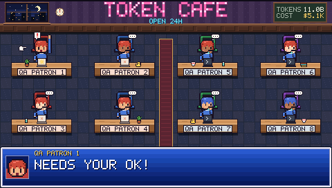
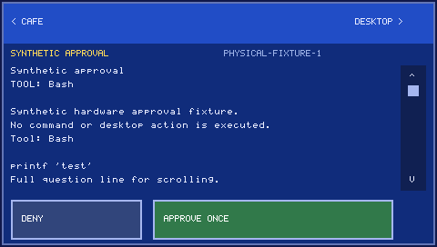
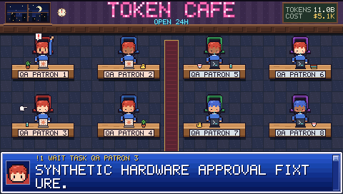

# Companion v2 staged validation ledger

Baseline: cmpham, ff2ff33. No production deployment before simulation gate passes.

| Gate | Status | Evidence |
|---|---|---|
| A. Protocol documentation and independent Claude Code review | PASS | Three review reports, review.md dispositions, compiled schema |
| B. Implementation, native tests, QEMU interaction and visual QA | PASS for implemented acceptance suite | 107 native tests, sanitizer corpus, final QEMU run |
| C. Physical board install and BLE/LCD/touch QA | Functional PASS; performance partial | Production installed; 100 cycles and request flow pass; local touch targets pass |
| D. Cross-platform regression and final report | macOS PASS; Linux pending CI/hardware | Shared tests and feature-disabled checks pass locally; report below |

Record failures and limitations, not only passing counts. Synthetic fixtures must
not contain real session/request content. Firmware files with provisioned pairing
keys remain ignored. Review findings and their dispositions belong in review.md.

## Baseline checks (before implementation)

- `cargo test --locked`: 63 library + 8 desktop tests passed (71 total).
  Log: `/tmp/tc-v2-baseline-rust.log`. This validates the unchanged baseline only.
- Protobuf compiler 1.71.0 tool package: `companion.proto` compiled successfully
  to a descriptor set and Python bindings in ignored `target/protocol-schema/`.
  This is schema syntax validation, not interoperability or runtime verification.
- Existing QEMU harness first encountered an obsolete frame fixture size; a fresh
  480×272 synthetic fixture was generated from the current desktop renderer.
  QEMU needs private Unix socket permissions outside the sandbox; rerun in progress.
- Initial sandboxed Claude CLI attempt could not read normal authentication.
  The authorized unsandboxed read-only review is authenticated and running.

Baseline QEMU rerun after rebuilding: PASS boot/PSRAM, frame CRC, bounds, invalid
length/version/CRC, fragmentation, reconnect, injected taps, 30 updates, pixel-exact
screenshot. See /tmp/tc-v2-baseline-qemu.log and target/protocol-schema/baseline-qemu.png.
Renderer feasibility: existing Rust scene/graphics/review/assets cross-compiled as
a no_std ESP32-S3 static library in ignored target/renderer-probe (not yet linked
or executed on ESP/QEMU). This permits one renderer implementation on both sides.

## Simulation checkpoint before the first board installation

- 101 native tests passed (25 UI, 14 core, 12 gesture/controller, 2 wire matrix,
  40 application library, 8 application window). Added task-churn regression also
  passes. All 16 payloads round-trip through the bounded C codec; fragment widths
  1..473 reconstruct exactly.
- `cargo clippy --workspace --all-targets --offline -- -D warnings`: passed.
- Feature-disabled application library/window tests: 32 + 8 passed on macOS.
  This is not a physical Linux BLE test.
- One million deterministic C decoder inputs under ASan/UBSan: passed, seed
  0xcafe1234; log `/tmp/tc-v2-fuzz.log`.
- QEMU actual Xtensa engine at ATT capacities 182/244/509: auth, snapshot, local
  selection before host reply, full review, scrolling, guarded decision and replay
  rejection passed. Additional eight-seat identity/double-tap routing, autonomous
  animation, ten-minute sleep/wake, reconnect, 64 sessions, bad text hash and MTU
  rejection passed. Latest log `/tmp/tc-v2-qemu-churn.log`.
- Screenshots inspected: `target/protocol-v2-qa/final-review.png`,
  `final-selected.png`, `final-overflow.png` (synthetic data only).
- Simulation checkpoint permits isolated physical QA. The comprehensive case
  inventory remains the reporting checklist; cases without direct evidence are
  not implicitly passed by this checkpoint.
- Full pre-v2 board flash and current executable preserved privately in
  `target/esp/backups/pre-v2/`. No factory/provisioning erase is required.

Implementation refinement: both firmware targets statically link the shared
`no_std` Rust UI/controller/crypto library. Nanopb validates bounded wire messages
before Prost allocation. ESP-IDF C provides BLE, LCD, touch, NVS and QEMU adapters.
This avoids a second implementation of pixel layout and gesture semantics.

## Final native and simulation verification (2026-10-14)

- 107 tests pass: shared UI 24, protocol core 14, controller 14, C/Rust wire
  matrix 2, application library 45, application window/input 8.
  `/tmp/tc-v2-done-tests.log`.
- Workspace Clippy with warnings denied and formatting pass.
  `/tmp/tc-v2-done-clippy.log`; feature-disabled Clippy also passes,
  `/tmp/tc-v2-no-ble-clippy.log`.
- Final C ASan/UBSan corpus: 1,000,000 inputs, seed 0xcafe1234, 103 syntactically
  accepted; no sanitizer failures. `/tmp/tc-v2-final-fuzz.log`.
- Final shared-engine QEMU run passes at ATT 182/244/509, plus eight-seat mapping,
  double-tap routing, sleep/wake, reconnect, large model, corrupt hash and low-MTU
  rejection. `/tmp/tc-v2-delivery-qemu-test.log`.
- CI now runs all workspace tests and the bounded C sanitizer corpus on both
  macOS and Linux. The workflow change has not yet run remotely; local evidence
  is macOS only. Physical Linux BLE remains untested.
- User-requested removal of automatic cycling is covered by tests: elapsed time
  never selects working patrons, changes manual selection, or rotates waiting
  focus. The default footer is a stable café summary; waiting indicators remain.

## Hardware failures found and corrected

1. A 2 ms FreeRTOS delay rounded to zero at 100 Hz, starving the idle task and
   triggering watchdog reset. The loop now yields at least one tick; the board
   profile uses 1000 Hz.
2. CoreBluetooth combined cached and advertised board names. Discovery now handles
   the exact advertised suffix while still verifying the pinned cryptographic ID.
3. Touch sampling and presentation initially used different clock origins. Both
   latency endpoints now use esp_timer; earlier underflowed numbers were discarded.
4. BLE write callbacks waited behind rendering. A bounded receive queue decouples
   ATT receipt from state application; only Applied proves synchronization.
5. Full-screen presentation and redundant pressed redraws inflated touch latency.
   The adapter now uses changed-column strips, a small pressed-feedback region,
   and defers redundant drawing during a short held contact. Only complete review
   presentation can arm approval; the feedback overlay cannot.
6. Session age increments caused needless model changes. Unchanged ages now refresh
   at most every 30 seconds; local idle animations continue without radio updates.
7. Non-ASCII session IDs used inconsistent appearance hashes; both sides now use
   the renderer's UTF-8 FNV-1a mapping.

## Coverage limits

Physical QA uses injected samples through the same gesture/controller path and
captures the rendered framebuffer. It does not prove physical finger detection,
photon latency, panel wiring/color, battery life or RF interference behavior.
QEMU does not emulate the actual radio, GT911 or NV3041A. No unrelated real
Claude/Codex request was approved during QA. Full two-board concurrency, power-loss
at every approval phase, 1000-action stress, and physical Linux BLE remain open
hardware scenarios from the larger test inventory, not implied passes.

## Release-candidate hardware result and production installation

Final isolated suite: **PASS**. Eight seat-to-session mappings, selected footer,
expanded approval, scrolling, synthetic decision, return to café, and 100 repeated
selection cycles passed. Six captures were CRC-checked and the café/review/stress
screens visually inspected. Each of the 113 semantic actions received a valid
result and a matching applied model revision. The fixture cannot open a desktop
session or dispatch a provider command.

| Measurement | Samples | Median | p95 | Maximum | Target |
|---|---:|---:|---:|---:|---|
| Sampled touch-down to local pressed marker LCD completion | 114 | 39 ms | 71 ms | 76 ms | p95 ≤75 ms: PASS |
| Sampled release to local content LCD completion | 114 | 86 ms | 88 ms | 152 ms | p95 ≤100 ms: PASS |
| Host action receipt to board Applied acknowledgement | 113 | 240 ms | 329 ms | 360 ms | p95 ≤200 ms: NOT MET |

Local optimistic display changes do not wait for the final acknowledgement.
Presentation profiling shows roughly 30–31 ms drawing, 15–16 ms RGB565 conversion,
and 18–28 ms LCD transfer in the eight-patron scene. Sustained animation is about
11–13 fps, so the 30 fps animation target is **not met**. This migration improves
local interaction substantially but is not a claim that every performance target
is complete. Cached text was used for the repeated selection test; initial text
fetch, provider polling and desktop-app launch latency are separate.

Evidence: `target/protocol-v2-board-release/` raw logs and captures (private ignored
local artifacts); repository synthetic summaries/screenshots in `qa/`.
`qa/latency.json` and `qa/results.json` preserve exact final counts.

The production firmware was built with `CONFIG_TC_QA_USB` unset, flashed and
hash-verified (`/tmp/tc-v2-production-install.log`). The matching Mac app was rebuilt
and started small/unpinned. Its inspected title reports
`BLE: TokenCafe-6336 synced v2`. Live desktop selection was visually verified.
Private production diagnostics are `target/protocol-v2-live-serial.log`; real
session screenshots/logs are not copied into the repository.

Production follow-up: observed the live board for 40 seconds without a disconnect,
watchdog, panic or error. Manual selection remained on the same live patron across
more than one minute, while other patrons updated normally. The shared display
adapter also compiles in retained legacy QA firmware (`/tmp/tc-v2-legacy-adapter-build.log`);
that build was not flashed. Physical finger/panel confirmation was requested from
the user and remains separate from automated injected-touch evidence.

## Clock synchronization follow-up (2026-10-14)

The board previously rendered its monotonic uptime as time of day. The host now
sends local milliseconds since midnight in HelloAck and each heartbeat; only the
rendered clock uses this anchor. All safety and inactivity deadlines remain
monotonic. Workspace tests pass (109 total), focused clock tests cover startup,
midnight rollover, missing samples, correction and invalid ranges; Clippy and
format checks pass. QEMU passes all three ATT capacities plus the extended suite,
including a comparison of only the clock pixels before/after an authenticated
time correction (`target/protocol-v2-qa/clock-noon.ppm`, `clock-0330.ppm`).
Production firmware was flashed with image-hash verification and the desktop app
rebuilt/restarted. Physical clock appearance still needs user confirmation; QEMU
screenshots are not a camera capture of the panel.

## Panel orientation and color follow-up (2026-10-14)

Historical calibration below was superseded by the live-frame check after fixing
chip-select routing. See the final follow-up below; do not reuse `0xc0`.

The user reported a 180-degree rotation and inverted colors even after reset.
The installed flash already contained the periodic `panel_orientation` helper.
The final correction sends standard MADCTL and inversion commands directly,
without surrounding them with vendor-page selection. The user confirmed `0xc0`
fixed orientation, but inversion OFF still produced inverted colors. The panel
therefore uses inversion-ON command `0x21` with `0xc0` and the original reversed
GT911 touch axes.
Boot diagnostics now read the panel over its bidirectional SDA line at 1 MHz.
The prior inversion-OFF readback is recorded in `target/display-direct-boot.log`.
The final color build was hash-verified on flash and reports MADCTL `c0` with
status `60 13 24 00` (inversion ON), in `target/display-color-boot.log`.

The focused native touch/gesture tests and production firmware build passed.
The application partition was flashed with hash verification, preserving NVS;
serial diagnostics confirmed rendering resumed. A private full-flash backup is
saved under `target/esp/backups/display-diagnosis-20261014.bin`. Orientation is
user-confirmed; final combined color and touch confirmation remains pending.
The QEMU rerun could not start because
this checkout lacks the generated `companion_pb2` Python module; no new QEMU pass
is claimed for this change.

## Frozen panel follow-up (2026-10-14)

Live serial capture showed continued BLE notifications and `V2: FRAME` messages
while the user reported a frozen panel (`target/frozen-board-live.log`). The
register-read diagnostic had registered a second SPI device on CS45, then removed
it. ESP-IDF `spi_bus_remove_device()` frees the CS GPIO via `gpio_reset_pin()`,
disconnecting the active display's chip-select despite successful SPI transfers.
The diagnostic now replaces the write device temporarily and recreates it after
removing the probe. Both write-device creation paths use one `lcd_config`.
The production firmware build passed and flash contents were hash-verified.
A 35-second post-flash capture recorded continued rendering without a captured
panic or assertion (`target/display-freeze-fixed-live.log`). Physical animation,
touch response, and final appearance confirmation remain pending.

## Orientation after restoring live rendering (2026-10-14)

After the chip-select fix, the user reported that the whole board was upside
down. The earlier apparent success with `0xc0` was observed while pixel updates
were blocked and cannot establish the orientation of freshly rendered frames.
MADCTL is now `0x00` in initialization and runtime restoration; inversion remains
ON (`0x21`). GT911 coordinates retain their native axes, and the focused native
touch/gesture tests pass with the matching mapping. Physical confirmation must
include visible animation and a touch-driven redraw, not only a static image.
Production build and flash hash verification passed. Post-reset readback reports
MADCTL `00` and status `00 13 24 00` (inversion ON), captured in
`target/display-live-orientation-boot.log`. Combined physical confirmation is
still pending.

## Physical touch calibration (2026-10-14)

The user tapped the top-left patron as requested. Serial capture recorded raw
contacts `(412,173)` and `(421,187)` in `target/touch-location-diagnosis.log`,
confirming both touch axes were reversed. The mapping now converts them to
`(67,98)` and `(58,84)` without changing MADCTL `0x00` or inversion ON. This
supersedes the native-axis assumption above: LCD orientation bits do not define
the physical touch sensor orientation. The native gesture test includes the
measured `(412,173)` calibration point and passes tap/double-tap cases.
The production build and flash hash verification passed. Post-flash physical
contacts map to top-left positions such as `(51,72)` and `(69,87)`, with immediate
hit feedback and release-triggered redraws recorded in
`target/touch-calibration-verification.log`. Desktop navigation from double taps
still requires user confirmation; firmware touch logs alone do not prove it.
