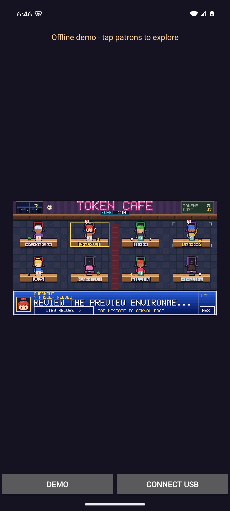
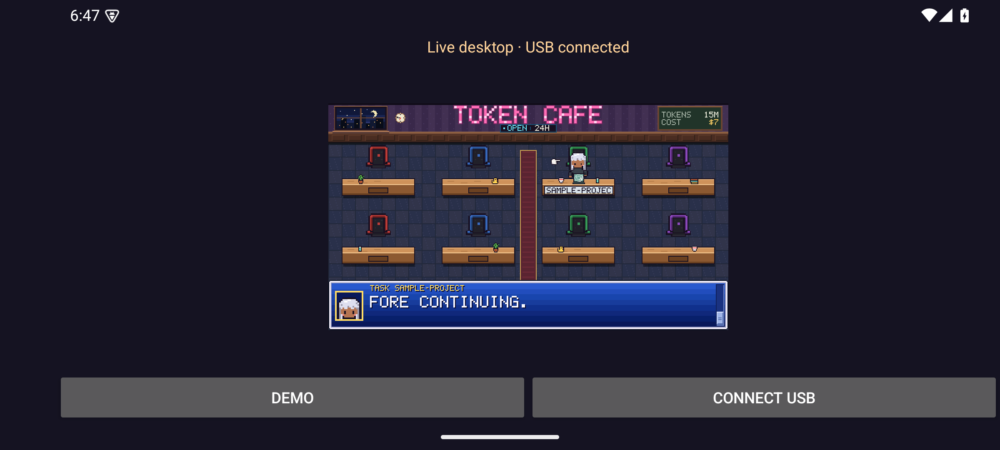
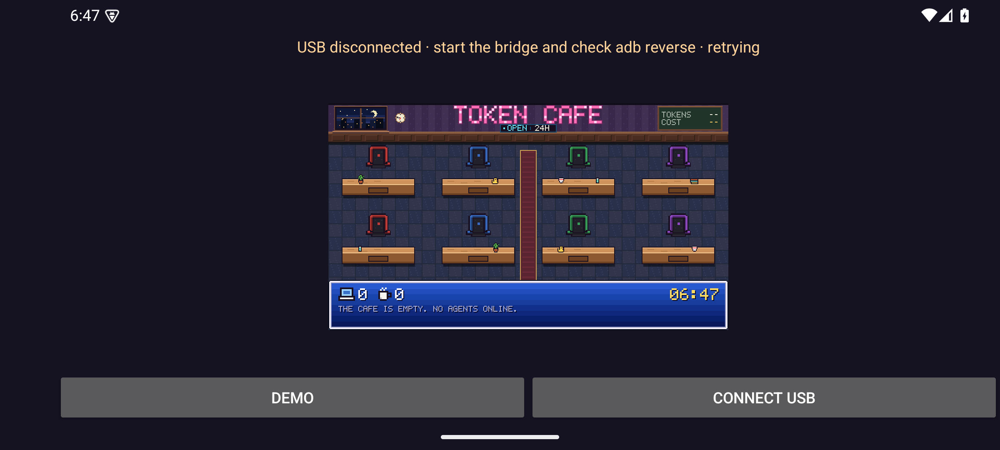

# Android validation — 2026-10-22

The initial Android companion builds into an installable debug APK at
`android/app/build/outputs/apk/debug/app-debug.apk`. No Play Store publication or
release signing was performed. Existing unrelated worktree changes were kept.

## Local checks

- Rust 1.90.0: `cargo test -p token-cafe-android --locked` — pass (snapshot
  validation rejects unsupported/oversized/malformed inputs without replacing
  the scene; an empty snapshot removes sessions).
- `cargo test --no-default-features --example android_bridge --locked` — pass
  (two tests: route/token rejection and actual loopback HTTP responses).
- Clippy with `-D warnings` — pass for the Android crate and bridge example.
- Targeted Rust formatting, shell syntax, Python compilation and
  `git diff --check` — pass.
- `./tools/build_android.sh`: ARM64 and x86-64 release Rust libraries, JNI C
  compilation, Java compilation, APK assembly and Android lint — pass. Lint
  reports no issues. Gradle 8.11.1, AGP 8.9.2, JDK 17, NDK 28.0.13004108,
  Android SDK 35, CMake 3.22.1.
- APK signature verification (debug v2 signature), `zipalign -c -P 16 4`, and
  all four native libraries' ELF LOAD alignment — pass.
- `tools/verify_android_apk.py` checks both renderer/JNI libraries are packaged
  for both ABIs, stored without compression at 16 KiB boundaries, have aligned
  ELF LOAD segments, and use dependency names without absolute build paths.

## Emulator checks

Headless Pixel 7, Android 15 / API 35 Google APIs ARM64 image. Tests used a local
HTTP fixture with made-up project/task data, authenticated through `adb reverse`.
The fixture exercised the Android transport and parser; it did not exercise
desktop process discovery or read real transcripts.

| Check | Result |
|---|---|
| Install, launch, offline animation and icon | Pass |
| Pairing with matching 64-character token | Pass |
| Live session and usage rendering | Pass |
| Patron tap selects task; scrollbar reaches final text | Pass, visually inspected |
| Rotation preserves credential and reconnects | Pass |
| Empty session list removes selection and animates departure | Pass |
| Incompatible snapshot clears scene and reports incompatibility | Pass |
| Remove ADB forwarding: scene clears and recovery instructions appear | Pass |
| Restore forwarding: connection recovers automatically | Pass |
| Background then foreground | Pass |
| Wrong token | Rejected, scene remains empty |
| Demo button after live mode | Disconnects and restores sample patrons |
| Java runtime fatal exceptions after loader fix | None observed |

Emulator testing found and fixed the JNI library recording an absolute host path
as its Rust dependency. The Rust library now has an explicit SONAME, and APK
verification guards the dependency names and presence of both libraries.

## Screenshots

All names and task text are synthetic. These are actual emulator captures.

## Remaining acceptance

No physical Android phone was connected. Physical USB cable behavior, real
desktop session discovery rendered on a phone,
x86-64 runtime, minimum API 26 runtime, 16 KiB runtime, battery/thermal behavior,
screen-reader session navigation and distribution signing remain unverified.
The dedicated Android CI workflow was added but has not run remotely.

## Real-bridge E2E follow-up

The [2026-10-22 simulator E2E run](e2e-2026-10-22.md) passed all 16 checks through
the real Rust bridge and collector using controlled live process/session files.
It includes bridge restart, credential replacement, and session removal after
process exit. The reusable runner and raw results are linked in that report.

## Branch extraction — 2026-10-27

The Android app, Rust client, authenticated read-only USB bridge, build scripts,
CI workflow and existing QA evidence were isolated onto `codex/android-companion`
from `cmpham/master` at `ee952b7`. Unrelated optimization and usage work was left
in the original checkout. Android client and bridge tests, strict Clippy,
workspace formatting, shell syntax and Python compilation were rerun successfully.
APK assembly and emulator checks above describe the October 22 run; they were
not repeated locally during extraction because the Android SDK and cargo-ndk
were unavailable. The Android CI workflow builds and validates both native ABIs.
