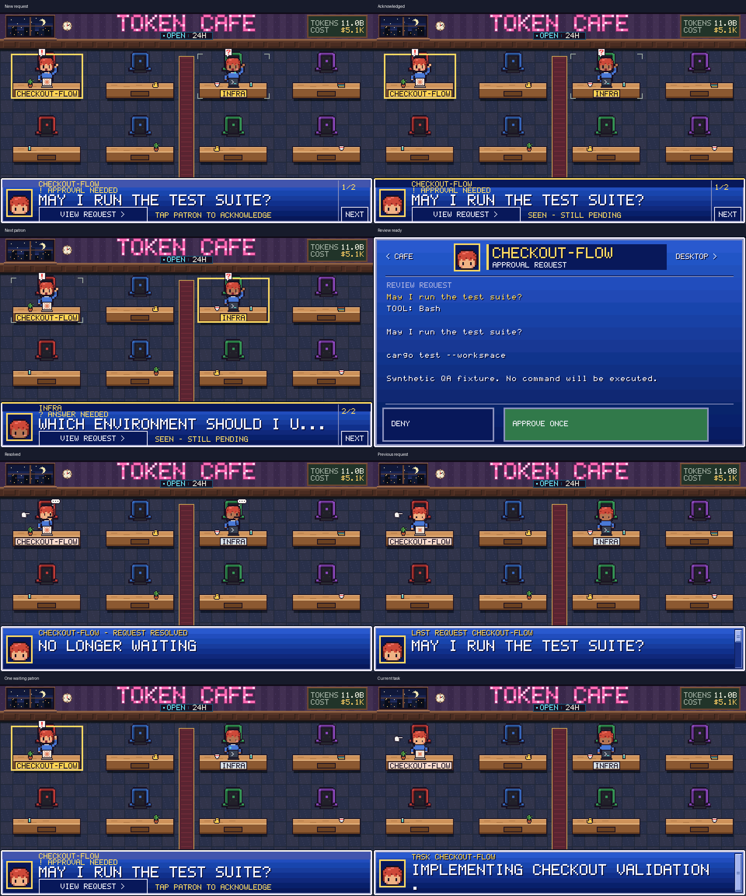

# Attention UI: QEMU verification

Verified on 2026-10-15 with the rebuilt Xtensa firmware in Espressif QEMU 9.2.2.
All sessions, requests, keys, and actions are synthetic. No real command was approved or run.

The latest simplification rerun verifies taller footer controls, removal of the single-waiter rail, a short acknowledgement hint, and approval controls appearing after the guard period. Protocol and transition results below are from the preceding verification run.

## Results

- `test_attention_qemu.py`: PASS, 15 lifecycle checks and 14 QMP framebuffer captures, including the polished UI and the full 30-second pulse window.
- `test_protocol_v2_qemu.py`: PASS at transport capacities 182, 244, and 509; additional seat identity, animation, sleep/wake, reconnect, 64-session, malformed body, and replay checks passed.
- `test_transition_qemu.py`: PASS for delayed navigation and local Back; review render round trips were 28.96–34.3 ms in this run (not physical board timings).

Native workspace tests: all 140 passed in the working tree. Before committing, the attention-only staged tree also passed the full workspace test suite independently. The QEMU captures and firmware hashes above came from the working tree, which additionally contains separate uncommitted performance optimizations. The physical ESP32 firmware build predates this final UI simplification; the current changes were rebuilt and tested in QEMU. No physical device was flashed.

The attention scenario verifies each 600 ms blink phase, a steady footer after 30 seconds, readable text throughout, immediate pulse suppression on acknowledgement, View/Next without a decision, marker removal on resolution, and wake on a replacement request identity. The board remains awake at 59,999 ms and can sleep at 60,000 ms when its touch idle deadline has already expired. Repeated snapshots neither extend that hold nor wake the sleeping engine.

The screenshots also verify a solid frame around the active patron, quiet markers around other waiters, matching seeded portraits in the footer and review, larger preview text, framed View/Next controls, explicit pending status, no Next action for a lone waiter, and resolved/history/current-task transitions.

The sleep screenshot is an explicit QEMU adapter simulation: the shared engine reports its sleeping flag, and the QEMU-only panel adapter presents black pixels. Production firmware uses that flag to switch the backlight GPIO. This verifies the state machine and emulated display behavior, not physical LCD power or touch behavior.

## Captures

The PNGs are QMP screendumps converted from PPM and enlarged exactly 2× with nearest-neighbor sampling. The contact sheet adds labels outside the captures.



- [Working](attention-01-working.png)
- [Sleeping](attention-02-sleeping.png)
- [New request: bright phase](attention-03-new-request-bright.png)
- [New request: dim phase](attention-04-new-request-dim.png)
- [Steady reminder](attention-05-steady-reminder.png)
- [Acknowledged](attention-06-acknowledged.png)
- [Next question](attention-07-next-question.png)
- [Read-only entry to review](attention-08-review.png)
- [Approval controls ready](attention-08b-review-ready.png)
- [Resolved](attention-09-resolved.png)
- [Last request, clearly labeled](attention-09b-last-request.png)
- [Fresh current task](attention-09c-current-task.png)
- [Replacement request wakes](attention-10-replacement-wakes.png)
- [Acknowledged during an active pulse](attention-11-early-acknowledgement.png)

Machine-readable evidence: [attention](results.json), [protocol](protocol-results.json), [transitions](transition-results.json), and [firmware hashes](firmware-sha256.json).

## Reproduce

```sh
bash tools/qemu_v2.sh build
bash tools/qemu_v2.sh test
```

The test runner now includes the attention scenario. It also runs the existing performance suite, which was not rerun for this UI-specific verification. Raw PPM captures and JSON results are written to `target/protocol-v2-qa/`.
